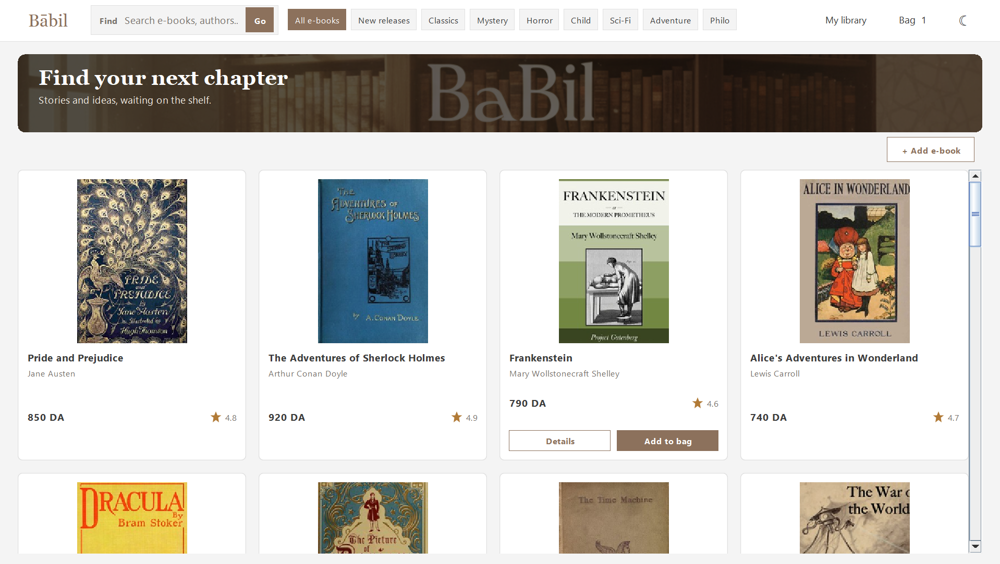
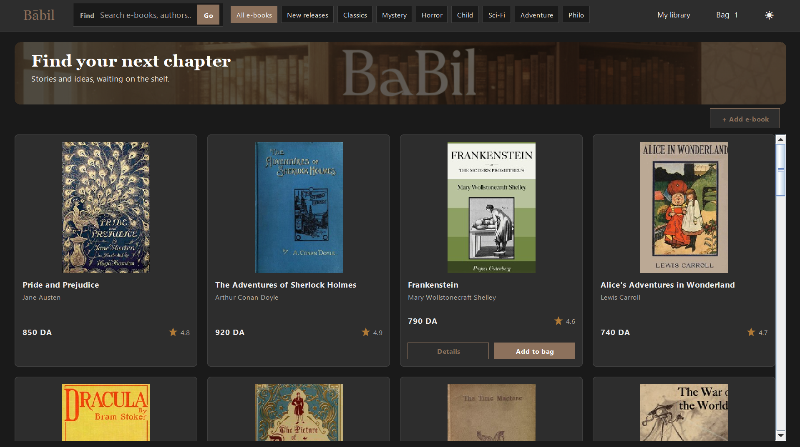

# Bābil Bookstore

Bābil est une librairie numérique de démonstration réalisée en Java Swing. Parcourez le catalogue, filtrez les livres par catégorie, consultez leurs détails, ajoutez des titres au panier et retrouvez vos achats dans la bibliothèque.

## Captures de l’application

| Mode clair | Mode sombre |
|---|---|
|  |  |

## Fonctionnalités

- Catalogue de 25 livres répartis en sept catégories.
- Couvertures locales et éditions numériques EPUB.
- Recherche, filtres, détails, panier et bibliothèque.
- Interface disponible en modes clair et sombre.
- Checkout simulé pour les démonstrations : aucun paiement réel n’est traité.

## Lancer l’application

Prérequis : un JDK 11 ou plus récent. Le pilote JDBC SQLite est fourni dans le dépôt.

Depuis la racine du dépôt, dans PowerShell :

```powershell
cd Babil
$sources = Get-ChildItem -Recurse src -Filter *.java | ForEach-Object FullName
javac -encoding UTF-8 -cp "lib\sqlite-jdbc-3.51.0.0.jar" -d bin $sources
java -cp "bin;lib\sqlite-jdbc-3.51.0.0.jar" App
```

Au premier lancement, l’application initialise le catalogue dans `data/books.db` à partir de `data/portfolio_books.json`.

## Données du catalogue

Les livres sont des classiques du domaine public référencés par Project Gutenberg. Les couvertures sont stockées dans `Babil/data/covers/` et les éditions EPUB complètes dans `Babil/data/ebooks/public-domain/`. Chaque édition conserve les notices de source et de licence de Project Gutenberg.

## Contenu du dépôt

- `Babil/src/` : application Java Swing, avec le point d’entrée `App.java`, les modèles et les écrans.
- `Babil/data/` : catalogue JSON, base SQLite, couvertures et éditions EPUB.
- `Babil/lib/` : pilote JDBC SQLite utilisé pour compiler et lancer l’application.
- `Babil/bin/` : classes Java compilées.
